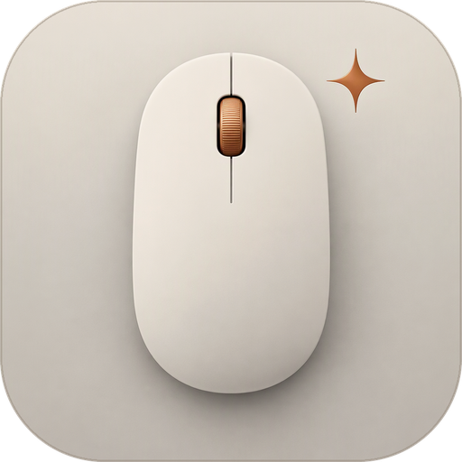
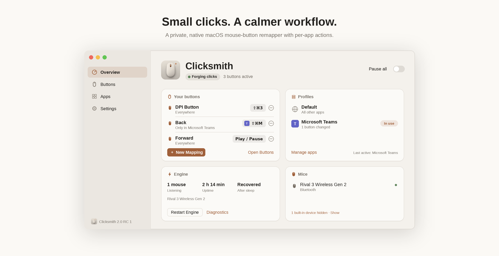
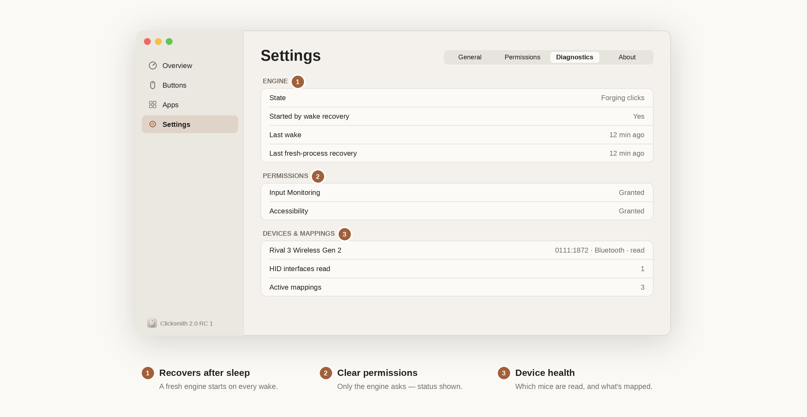

<p align="center">
  
</p>

<h1 align="center">Clicksmith</h1>
<p align="center"><strong>Small clicks. A calmer workflow.</strong></p>
<p align="center">A private, native macOS mouse-button remapper with per-app actions, a low-latency input engine and a calm Nordic interface.</p>

<p align="center">
  
  
  
  
</p>

<p align="center">
  <a href="#install">Install</a> ·
  <a href="#what-clicksmith-does">Features</a> ·
  <a href="#privacy--security">Privacy</a> ·
  <a href="docs/ARCHITECTURE.md">Architecture</a> ·
  <a href="docs/CHANGELOG.md">Changelog</a>
</p>



> **Release candidate**
> Clicksmith 2.0 RC 1 is the first release candidate. It has been used daily on a SteelSeries Rival 3 Wireless Gen 2; feedback from other mice and Macs is very welcome before 2.0 final.

## What Clicksmith does

- **Map every button** — standard buttons and HID-exposed extras such as DPI buttons.
- **Different per app** — Back can mute in Microsoft Teams and go back everywhere else.
- **Native actions** — keyboard shortcuts, media keys, open an app, type text, or block the original action.
- **Honest status** — one health model tells you whether you're ready, paused, missing a permission or without a mouse.
- **Wake-proof** — after sleep the engine restarts as a fresh process, so buttons keep working.
- **Light on your Mac** — the built-in trackpad and keyboard are ignored unless you map them.
- **Local by design** — no telemetry, analytics, network service or keystroke logging.

## Button mapping


Click a button on the mouse drawing, press it once, and choose what it does. Every row shows the real result — `⇧⌘3`, `Play / Pause`, or a Teams icon with `⇧⌘M` — instead of raw HID details.

## Per-app profiles


One default for all apps, plus small overrides for the apps where a button should behave differently. Switching apps only changes the engine's work when an app with its own profile comes to the front.

## Diagnostics you can trust



Engine state, wake recovery, permissions and the devices being read are all visible in Settings › Diagnostics. `./scripts/verify.sh 20` checks the same from Terminal and measures engine CPU and memory.

## Install

Requirements: macOS 13 or newer and Apple's Command Line Tools (`xcode-select --install`).

```bash
git clone https://github.com/samuelort/clicksmith.git
cd clicksmith
./scripts/install.sh
```

The installer checks every file against the release manifest, builds, runs the 94 core self-tests, installs to `/Applications` and opens Clicksmith. Then follow **Finish setup** in the app: allow **Clicksmith Engine** under *System Settings › Privacy & Security › Input Monitoring* and *Accessibility*, and press **Restart Engine**.

Health check:

```bash
./scripts/verify.sh 20
```

## Privacy & security

- Only **Clicksmith Engine** holds Input Monitoring and Accessibility; the settings app needs neither.
- No network code, update service, analytics or telemetry.
- Every action needs a physical button press — nothing else can trigger one.
- Typed text is never sent into password fields.
- **Open app** only launches apps installed in an Applications or system folder.
- Settings live in owner-only files; blocking left/right click needs explicit opt-in and keeps ⌃⌥⌘⎋ as an emergency pause.

Full details and known limits: [SECURITY.md](SECURITY.md).

## Architecture

```text
Clicksmith.app (AppKit + SwiftUI)          Clicksmith Engine.app (IOHID + CGEvent)
UI, settings, diagnostics      ── JSON ─▶   input, actions, wake recovery
no input permissions           ◀─ status ─  owns input permissions
```

Hot path: `IOHID report → rising edge on a watched bit → repeat guard → native action`. No logging, file I/O or UI work on that path. More in [docs/ARCHITECTURE.md](docs/ARCHITECTURE.md).

## Feedback

Please include your Mac model, macOS version, mouse model and connection, the button that misbehaved and the output of `./scripts/verify.sh 20`. Never include passwords or text snippets.

## Roadmap

- 2.0 final after release-candidate feedback
- Developer ID signing and a notarized drag-to-install DMG
- Windows version as a native sibling with the same design

MIT License.
