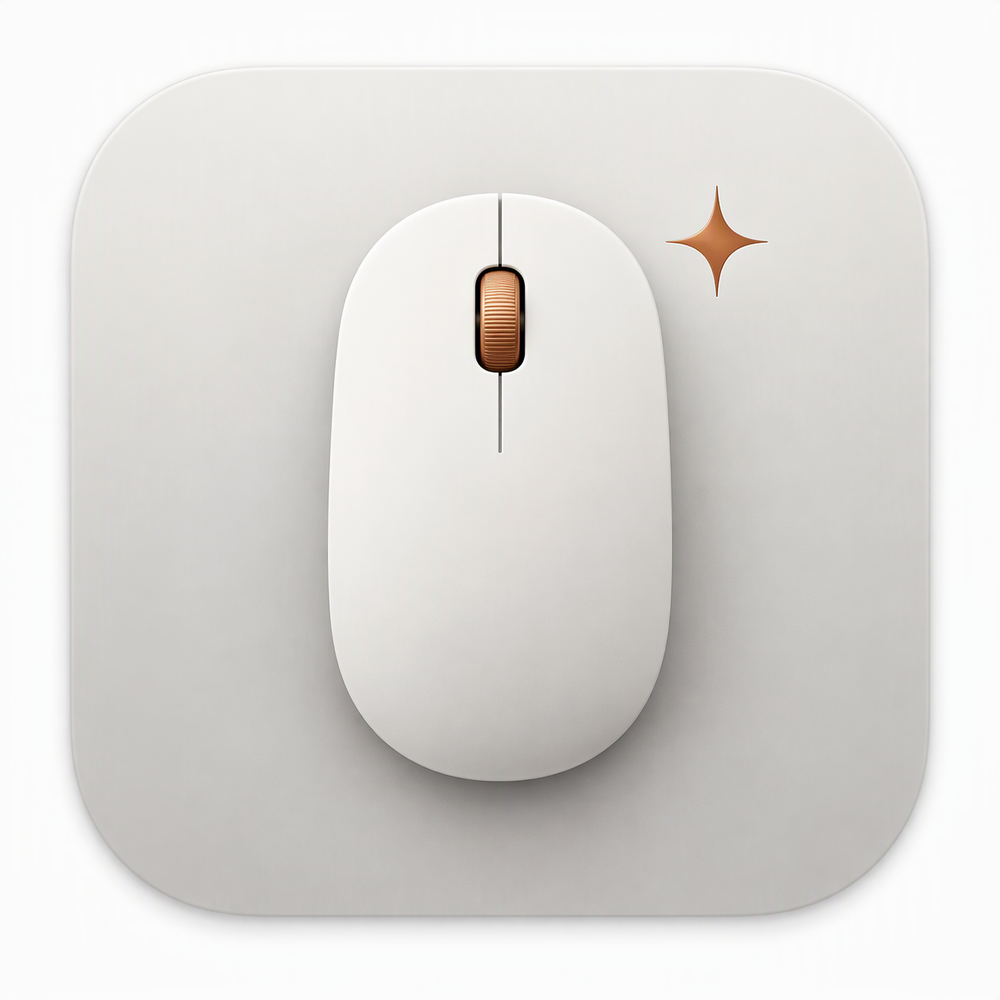
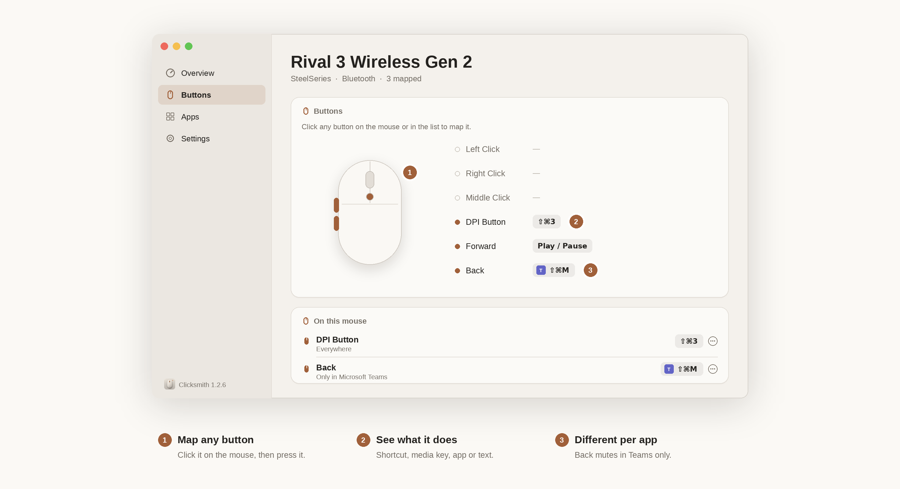
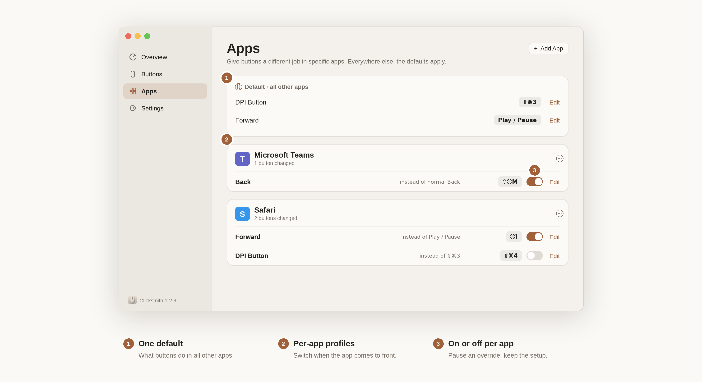

<p align="center">
  
</p>

<h1 align="center">Clicksmith</h1>
<p align="center"><strong>Small clicks. A calmer workflow.</strong></p>
<p align="center">A privacy-first, native macOS mouse-button remapper with per-app actions, a low-latency input engine and a calm Nordic interface.</p>

<p align="center">
  
  
  
  
</p>

<p align="center">
  <a href="#install">Install</a> ·
  <a href="#what-clicksmith-does">Features</a> ·
  <a href="#privacy--security">Privacy</a> ·
  <a href="docs/ARCHITECTURE.md">Architecture</a> ·
  <a href="CONTRIBUTING.md">Contribute</a>
</p>


> **Beta status**  
> Clicksmith is ready for a small private macOS beta. The input engine and wake recovery have been exercised on a SteelSeries Rival 3 Wireless Gen 2, but the project still needs broader coverage across mouse models and Macs before a public beta.

## What Clicksmith does

Clicksmith turns physical mouse buttons into useful actions without putting a scripting layer in the input path.

- **Map every button** — normal buttons and HID-exposed extra buttons, including DPI-style buttons.
- **Different actions per app** — for example, Back can mute in Microsoft Teams and behave normally everywhere else.
- **Useful native actions** — keyboard shortcuts, media keys, open an app, type text or block the original button action.
- **Wake-proof engine** — the engine exits cleanly after wake and lets `launchd` start a fresh process with a fresh HID stack.
- **Low idle overhead** — built-in trackpads/keyboards are not listened to unless needed.
- **Local by design** — no telemetry, analytics, network service or keystroke logging.

## Button mapping, without the clutter



Click a button, learn the physical input, then give it a job. The action is resolved in memory before the press reaches the hot path.

**Example**

```text
DPI button     → ⇧⌘3 screenshot       everywhere
Back           → ⇧⌘M mute             Microsoft Teams only
Back           → normal Back          everywhere else
Forward        → Play / Pause          everywhere
```

The app shows the effective action and scope rather than surfacing raw HID details unless Advanced is opened.

## One mouse, different apps



App activation is observed by bundle identifier. Clicksmith only rebuilds watched button lists when switching into or out of an app that actually has an override; ordinary app switches only update coalesced status.

That gives you context-aware behaviour without turning the app into a macro system.

## Fast, local and deliberately boring underneath


The hot path is intentionally tiny:

```text
IOHID report
    ↓
rising-edge test for watched button bits
    ↓
per-button repeat guard
    ↓
native macOS action
```

No logging, disk I/O, scripts, UI work or network access belongs between the HID callback and shortcut/media event posting.

## Install

### Requirements

- macOS 13 Ventura or newer
- Apple Command Line Tools or Xcode
- A mouse whose extra buttons are exposed to macOS HID

### Private beta install

1. Open Terminal.
2. Run:

```bash
git clone https://github.com/samuelort/clicksmith.git
cd clicksmith
./scripts/install.sh
```

4. In **System Settings → Privacy & Security**, enable **Clicksmith Engine** under:
   - Input Monitoring
   - Accessibility

The installer verifies the release manifest before it builds. A changed, missing or unexpected source file stops a normal installation. Developers can intentionally bypass that check with `./scripts/install.sh --dev`.

### Verify the installation

```bash
./scripts/verify.sh 20
```

The health check inspects the installed app and engine versions, signatures, engine process, permissions, file privacy, HID listeners and approximate CPU/memory consumption.

## Nordic design system

The interface follows the same visual language as the app icon:

| Token | Use |
|---|---|
| Copper | primary actions, links, mapped controls |
| Warm paper | light-mode canvas |
| Soft stone | sidebar, borders, quiet fills |
| Warm charcoal | dark-mode canvas |
| Sage | healthy/running/granted |
| Amber | paused/warning |
| Clay | stopped/error |

The goal is calm rather than decorative: restrained hierarchy, generous spacing, soft surfaces and one accent colour.

## Privacy & security

Clicksmith asks macOS for powerful permissions, so the boundaries are intentionally narrow.

- Only **Clicksmith Engine** needs Input Monitoring and Accessibility.
- No network code, update service, analytics SDK or telemetry.
- No generic IPC endpoint that can inject shortcuts. An action still requires a physical button press.
- Typed-text actions are skipped while macOS secure input is active.
- Configuration/IPC files must be regular files owned by the current user and not writable by other users.
- Settings directory uses `0700`; sensitive local files use `0600`.
- Blocking left/right click requires explicit opt-in, and `⌃⌥⌘⎋` is forced on as an emergency pause when primary-button suppression is allowed.

Read the full threat model and known limits in [SECURITY.md](SECURITY.md).

## Architecture

Clicksmith is two processes:

```text
┌─────────────────────────┐        JSON + Darwin notifications       ┌─────────────────────────┐
│ Clicksmith.app          │  ─────────────────────────────────────▶  │ Clicksmith Engine.app   │
│ AppKit + SwiftUI        │                                          │ IOHID + CGEvent          │
│ UI, config, diagnostics │  ◀─────────────────────────────────────  │ actions + wake recovery │
└─────────────────────────┘               status / learn             └─────────────────────────┘
           no input permission                                          owns input permission
```

More detail: [docs/ARCHITECTURE.md](docs/ARCHITECTURE.md).

## Supported actions

| Action | Native implementation |
|---|---|
| Keyboard shortcut | `CGEvent` key down/up |
| Media / volume / brightness | macOS system-defined media events |
| Open app | `NSWorkspace` by bundle identifier |
| Type text | Unicode `CGEvent` events; blocked during secure input |
| Block original button | session event tap, only while required |

## Project layout

```text
Sources/
  Clicksmith/          macOS UI + menu bar + engine lifecycle
  ClicksmithCore/      config model, validation, pure engine logic
  ClicksmithEngine/    IOHID input engine + action posting
  ClicksmithSelfTest/  XCTest-free core verification
Tests/
  ClicksmithCoreTests/
scripts/               build, install, verify, diagnose, release
Resources/             app + menu bar artwork
docs/                  architecture, config, test and release notes
assets/                 GitHub/marketing artwork only
```

## Development

```bash
swift build -c release
"$(swift build -c release --show-bin-path)/ClicksmithSelfTest"
```

For changes to parser, mapping, learning, safety or context resolution, add a core check before changing behaviour.

To install your own modified checkout:

```bash
./scripts/install.sh --dev
```

## Beta feedback

When reporting a beta issue, include:

- Mac model and macOS version
- mouse brand/model and connection type
- Clicksmith version
- which physical button failed
- whether the problem survives an engine restart
- output from `./scripts/verify.sh 20`

Do **not** include passwords, typed-text snippets or other secret content.

## Roadmap

- Broader macOS beta across Logitech, SteelSeries, Razer and generic HID mice
- Developer ID signing + notarized DMG for public distribution
- More accessibility and keyboard-navigation QA
- Windows port as a separate native input engine, sharing Clicksmith’s concepts and visual language

## License

MIT. See [LICENSE](LICENSE).
