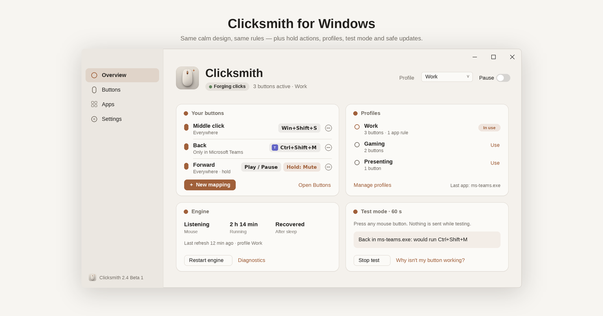

<p align="center"></p>

<h1 align="center">Clicksmith for Windows</h1>
<p align="center"><strong>Small clicks. A calmer workflow.</strong><br>
Give every mouse button a job — a shortcut, a media key, an app or a snippet — everywhere, or differently in each app.</p>

<p align="center">
  
  
  
</p>



> **Beta.** This is the first Windows build. It has been written to the same design and rules as the macOS app, but it still needs to be built and tested on real Windows PCs. Please report what you find.

## Install

1. Download or clone this repository.
2. Open the `windows` folder and double-click **`install.cmd`** (or run `.\install.cmd` in Terminal).

The installer checks every file against the release manifest, installs the free .NET 8 SDK with winget if it's missing (it asks first), builds, runs the self-tests, backs up your setup, installs to your user folder (no administrator needed), and opens Clicksmith.

| Command | What it does |
|---|---|
| `install.cmd` | Build and install (`-NoAnim` for plain output, `-Dev` for your own changes) |
| `update.cmd` | `git pull`, then reinstall — your setup is backed up and the previous version is kept |
| `rollback.cmd` | Go back to the previous version |
| `verify.cmd` | Health check plus real CPU/memory use of the engine |
| `uninstall.cmd` | Remove Clicksmith (`-Purge` also removes your setup and backups) |

## What it does

- **Five buttons on every mouse:** left, right, middle, Back and Forward. Left/right stay normal unless you allow changing them.
- **Actions:** keyboard shortcut, media key, open an app, type text, or disable.
- **Hold for a second action (2.2):** a quick press does one thing, holding does another — never both.
- **Per-app actions:** Back can mute in Microsoft Teams and go back everywhere else.
- **Profiles (2.3):** Work, Gaming, Presenting… switch from the Overview or the tray icon.
- **Test mode (2.1):** press a button and see exactly what it would do in the app in front — without running it.
- **Find a button, suggestions and troubleshooting (2.1)** on the Buttons page.
- **Automatic backups (2.1):** the last 20 versions of your setup, with preview and restore.
- **Safe updates (2.4):** verified files, a backup of your setup, the previous version kept, automatic rollback on failure, and an opt-in update check.
- **Refreshes itself** after sleep and unlock, so buttons keep working.
- **Calm Nordic design** in light and dark mode, matching the macOS app.

## Privacy and safety

- No account, no telemetry, no analytics. The network is only used when you check for updates.
- Clicksmith never logs which buttons you press or what you type.
- Every action needs a physical button press.
- **Open app** only launches programs installed in Program Files, AppData\Programs or Windows.
- **Type text** is skipped on Windows sign-in prompts. Don't store passwords in snippets — they're saved unencrypted.
- **Ctrl+Alt+Shift+F12** pauses everything instantly, and stays on while left/right click can be changed.

## Known limits

- Windows only reports five mouse buttons. Extra buttons (such as a DPI button) are handled by the mouse itself and can't be mapped.
- Apps running as administrator ignore input from normal apps, so Clicksmith's actions don't reach them.
- Settings files are Windows-specific; they can't be imported into the macOS app.

## Build it yourself

```powershell
dotnet build src\Clicksmith.SelfTest -c Release; dotnet src\Clicksmith.SelfTest\bin\Release\net8.0\Clicksmith.SelfTest.dll
.\install.cmd -Dev
```

More: [Architecture](docs/ARCHITECTURE.md) · [Test plan](docs/TESTPLAN.md) · [Changelog](docs/CHANGELOG.md)

MIT License.
