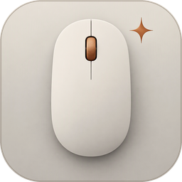
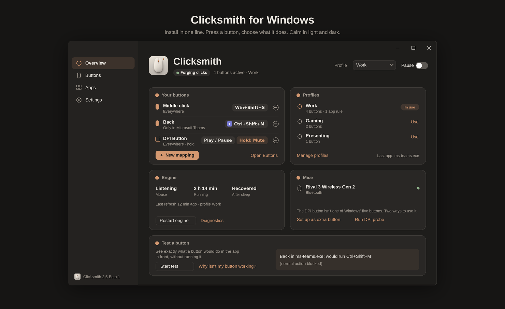

<p align="center"></p>

<h1 align="center">Clicksmith for Windows</h1>
<p align="center"><strong>Small clicks. A calmer workflow.</strong><br>
Give every mouse button a job — a shortcut, a media key, an app or a snippet — everywhere, or differently in each app.</p>

<p align="center">
  
  
  
</p>


<details><summary>Dark mode</summary>



</details>

> **Beta.** Built to the same design and rules as the macOS app. It still needs testing on real Windows PCs — please report what you find.

## Install

Pick one. All three install for your user only — no administrator rights.

**1. Terminal (recommended).** Open PowerShell and paste:

```powershell
irm https://raw.githubusercontent.com/samuelort/clicksmith/main/windows/get.ps1 | iex
```

It downloads the newest Windows release for your PC, checks its SHA-256, and runs the installer with the forge animation, a backup of your setup and automatic rollback.

**2. Setup.exe.** Download `Clicksmith-Setup-<version>.exe` from [Releases](https://github.com/samuelort/clicksmith/releases) and run it.

**3. From source** (for developers): open the `windows` folder and run `install.cmd` (needs the .NET 8 SDK; the installer offers to install it).

The prebuilt app needs the free **.NET 8 Desktop Runtime**; every installer checks for it and offers to install it with winget.

> **SmartScreen:** Clicksmith isn't code-signed yet, so Windows may show *“Windows protected your PC”* for Setup.exe. Choose **More info › Run anyway** — or use the terminal install, which verifies the download itself.

| Command (source folder) | What it does |
|---|---|
| `install.cmd` | Build and install (`-NoAnim` plain output, `-Dev` for your own changes) |
| `update.cmd` | `git pull`, then reinstall — setup backed up, previous version kept |
| `rollback.cmd` | Go back to the previous version |
| `verify.cmd` | Health check plus real CPU/memory use of the engine |
| `uninstall.cmd` | Remove Clicksmith (`-Purge` also removes your setup and backups) |

Updating an installed copy: **Settings › Updates › Download and install.**

## What it does

- **Five buttons on every mouse** (left, right, middle, Back, Forward). Left/right stay normal unless you allow changing them.
- **Extra buttons (F13–F24):** if your mouse's software can make a button — such as DPI — send F13–F24, Clicksmith turns it into a full button.
- **Actions:** keyboard shortcut, media key, open an app, type text, or disable.
- **Hold for a second action:** a tap does one thing, holding does another — never both.
- **Per-app actions** with real app icons. Back can mute in Teams and go back everywhere else.
- **Profiles:** Work, Gaming, Presenting… switch from the Overview or the tray.
- **New mapping:** press the button, then choose what it does.
- **Test mode:** see exactly what a press would do in the app in front — without running it.
- **Find a button, suggestions, troubleshooting** and a **welcome guide**.
- **Automatic backups** of your setup (last 20) with preview and restore.
- **Safe updates:** verified packages, setup backup, previous version kept, automatic rollback.
- **Refreshes itself** after sleep and unlock, so buttons keep working.
- **Calm Nordic design** in light and dark mode, keyboard- and Narrator-friendly.

## About the DPI button

Windows' own mouse driver only passes the five standard buttons to apps; extra buttons such as DPI are dropped before any app can see them. Two routes:

1. **Extra button:** set the mouse software (e.g. SteelSeries GG) to send F13–F24 from the button, then map it under **Buttons › Extra buttons**.
2. **DPI probe:** *Settings › Diagnostics › Run DPI probe* (read-only) checks whether your mouse exposes a readable vendor channel — try it via Bluetooth and via the 2.4 GHz receiver, and share the report. If the button shows up there, a future version can read it directly.

## Privacy and safety

- No account, telemetry or analytics. The network is only used to check for and install updates.
- Clicksmith never logs which buttons you press or what you type.
- Every action needs a physical button press.
- **Open app** only launches programs installed in Program Files or AppData\Programs — never command shells or script hosts.
- **Type text** is skipped in password fields and on Windows sign-in prompts. Don't store passwords in snippets — they're saved unencrypted.
- **Ctrl+Alt+Shift+F12** pauses everything instantly, and stays on while left/right click can be changed.

## Known limits

- Not code-signed yet (SmartScreen notice, see above).
- Apps running as administrator ignore input from normal apps, so Clicksmith's actions don't reach them.
- Settings files are Windows-specific; they can't be imported into the macOS app.

More: [Architecture](docs/ARCHITECTURE.md) · [Test plan](docs/TESTPLAN.md) · [Changelog](docs/CHANGELOG.md) · [Releasing](docs/RELEASING.md)

MIT License.
